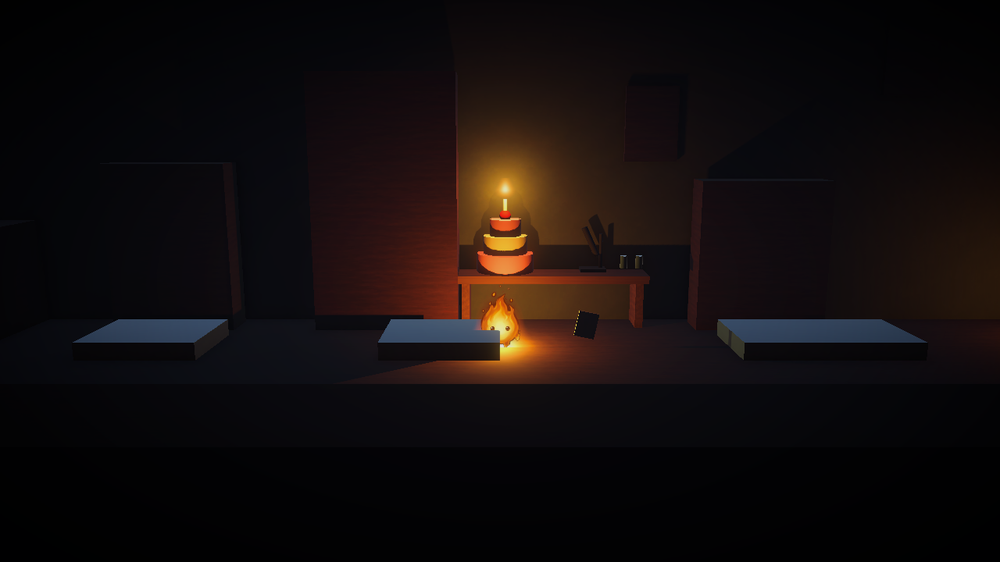

# Огонёк

Игра для геймджема MyIndie Level 11, тема «Не дай погаснуть».

Самая длинная ночь в году. Есть старый обычай: последний огонь из каждого дома несут к Большому костру на лесной поляне, иначе зима не уйдёт. Дом давно пуст, нести огонь некому. В остывшем камине тлеет последний уголёк, Игни, и он идёт сам: через холодный дом, сырой подвал, тёмную канализацию, вентиляционную шахту и зимний лес.

Огонёк — это и жизнь, и свет. Топливо тает всегда, а размер пламени выбираешь сам: большое светит дальше и прыгает выше, но сгорает быстрее; маленькое почти ничего не видит, зато живёт дольше.

## Как играть

Браузерная сборка: архив `Ogonyok-WebGL.zip` (папка `Unity/Builds/WebGL`) — открыть `index.html` через любой веб-сервер или залить на страницу игры как HTML5. Звук включается после первого нажатия.

| Клавиша | Действие |
|---|---|
| A D / стрелки | идти |
| Пробел | прыжок; в тёплом потоке держать для подъёма |
| W / стрелка вверх | пламя больше: маленькое → обычное → большое |
| S / стрелка вниз | пламя меньше: фитилёк пролезает в решётку |
| Shift / X | вспышка-рывок (−15% топлива, поджигает верёвки, рушит тонкий лёд) |
| E (держать) | отдать пламя (котёл, финальный костёр) |
| Esc | пауза: продолжить, начать с чекпоинта, настройки, управление, меню |

## Шесть зон

1. **Холодный дом.** Сквозняк порывами из разбитых окон (штора вздувается заранее), паутина, капли и лужи, лёд в проёмах, шкаф-мост на верёвке.
2. **Подвал.** Старый котёл: отдай ему часть себя, и трубы потеплеют. Решётка только для фитилька.
3. **Канализация.** Вода гасит мгновенно, по течению плывут плоты, пузыри метана подбрасывают и подпитывают.
4. **Вентиляционная шахта.** Тёплые потоки вверх, вентилятор: проскочить между лопастями или пережечь ремень.
5. **Лес.** Холод ускоряет расход, снег, ветер, замёрзший ручей: лёд тает от любого огня, маленький держится на нём дольше всех.
6. **Костёр.** Отдай себя целиком.

Свечи, керосинка, газовый факел и смола — чекпоинты. Газеты, тряпки и шишки подпитывают.

В уровне спрятаны три пасхалки по карточкам джема: лаборатория торта, легендарная пицца предков и тюлень.

## Разработка

Unity 6000.3.11f1, URP, 2.5D, целевая платформа WebGL. Проект в папке `Unity/`, сцена `Assets/Scenes/Level1.unity`.

- Уровень собирается кодом: **Ogonok → Build Level 1** (`OgonokBuilder`, ASCII-сетка зон). Сцену руками не править, после правок билдера пересобрать и закоммитить.
- **Ogonok → Build WebGL** — сборка в `Unity/Builds/WebGL`.
- Тесты: Window → General → Test Runner → PlayMode.
- Документы: концепция `docs/concept.md`, карточки задач `docs/PROMPTS.md`, решения `implementation-notes.md`, звук `docs/audio-*.md`, текстуры `outputs/textures/greybox/INTEGRATION.md`.
- `index.html` в корне — ранний веб-прототип механик, для истории.

Арт и звук: сгенерированные текстуры и SFX (промпты в `outputs/` и `docs/audio-elevenlabs.md`), музыка «Fading Velvet Loneliness», шрифт интерфейса Roboto Italic (Apache 2.0).

## Команда

Егор Кузнецов, Daniil K., Crucial, Gr1nis.
